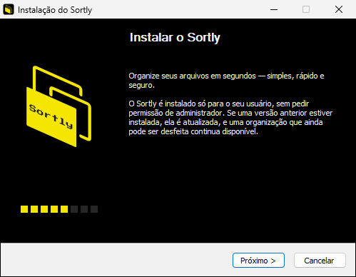
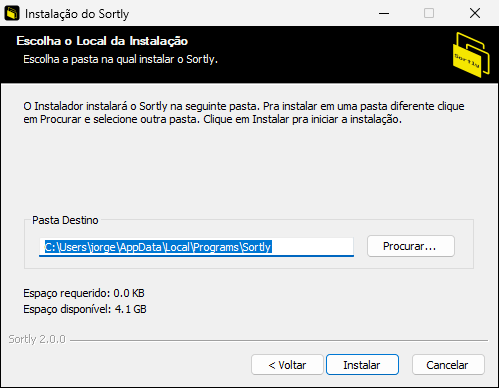
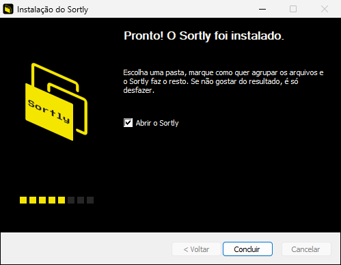

# Versões e empacotamento

> Autores: Caio Reis, Claude

Como gerar uma nova versão do Sortly e o que cada pacote contém.

## 1. Versionamento

- O projeto segue o [Versionamento Semântico](https://semver.org/lang/pt-BR/): `MAIOR.MENOR.CORREÇÃO`.
- A versão do app fica em **um lugar só**: `info.productVersion` no [`wails.json`](../wails.json). Ela vai para o executável, o instalador, o `Info.plist` do macOS e o pacote `.deb`.
- O [`CHANGELOG.md`](../CHANGELOG.md) registra o que muda para o usuário. A seção `[Não lançado]` vira a nova versão no momento do release.

## 2. Gerar uma versão

1. Atualize `info.productVersion` no `wails.json` (ex.: `2.0.0`).
2. No `CHANGELOG.md`, renomeie `[Não lançado]` para `[2.0.0] - AAAA-MM-DD` e crie uma seção `[Não lançado]` vazia acima dela.
3. Faça o commit (`chore(sortly-N): prepara a versão 2.0.0`), o merge na `main` e crie a tag:

   ```bash
   git tag v2.0.0
   git push origin v2.0.0
   ```

4. O workflow [`release.yml`](../.github/workflows/release.yml):
   - confere se a tag bate com o `productVersion` (se não bater, falha antes de compilar);
   - gera os pacotes das três plataformas;
   - cria um **rascunho** de release no GitHub com os arquivos anexados.
5. Revise o rascunho, cole as notas da versão a partir do CHANGELOG e publique.

Em pull requests que alteram `build/**`, `wails.json` ou o próprio workflow, o `release.yml` também roda, mas só gera os pacotes como artefatos do workflow, sem criar release. Assim o instalador, o `.dmg` e o `.deb` são validados antes de uma versão.

## 3. Pacotes gerados

| Plataforma | Arquivo | Conteúdo |
|---|---|---|
| Windows | `Sortly-<versão>-windows-amd64-setup.exe` | Instalador NSIS |
| Windows | `Sortly-<versão>-windows-amd64-portable.exe` | Só o executável (precisa do WebView2, já presente no Windows 10/11 atualizados) |
| macOS | `Sortly-<versão>-macos-universal.dmg` | `Sortly.app` universal (Intel e Apple Silicon) com atalho para Aplicativos |
| macOS | `Sortly-<versão>-macos-universal.zip` | O mesmo `.app`, compactado |
| Linux | `Sortly-<versão>-linux-amd64.deb` | Pacote Debian/Ubuntu (gerado com [nfpm](https://nfpm.goreleaser.com/)) |
| Linux | `Sortly-<versão>-linux-amd64.tar.gz` | Só o binário |

### 3.1 Windows (NSIS)

Configuração em [`build/windows/installer/project.nsi`](../build/windows/installer/project.nsi). O arquivo `wails_tools.nsh` é regerado pelo Wails a cada build e não deve ser editado.

- **Instalação por usuário**, sem pedir administrador, em `%LOCALAPPDATA%\Programs\Sortly`, como a versão 1.0.
- Atalhos no menu Iniciar e na área de trabalho; opção de abrir o app ao concluir.
- Telas em português ou inglês, conforme o idioma do sistema.
- Instala o WebView2 Runtime se ele não existir (bootstrapper da Microsoft).
- Ícones do instalador e do desinstalador: `build/windows/icon.ico`.
- **Visual do design system** (MUI2):
  - telas de boas-vindas e conclusão pretas, com a imagem lateral `resources/welcome.bmp` (164×314: a logo e os blocos da barra de progresso);
  - cabeçalho preto com a logo nas telas internas (`resources/header.bmp`, 150×57, à direita);
  - textos próprios em PT e EN (`LangString` no fim da lista de idiomas);
  - "Sortly <versão>" no rodapé, no lugar de "Nullsoft Install System".
- **Imagens:** são de 96 dpi; em telas com mais escala, o NSIS as estica. Se a logo mudar, as duas são refeitas a partir dela (preto `#000000`, amarelo `#F5E600`).
- **Caixa "Abrir o Sortly":** fica sem o tema visual do Windows, que ignoraria a cor do texto e o desenharia preto sobre o fundo preto.
- **Codificação:** o `project.nsi` é UTF-8 **com BOM**. Sem ele, o `makensis` lê o arquivo como ANSI, e os acentos saem quebrados.

| Boas-vindas | Pasta | Conclusão |
|---|---|---|
|  |  |  |
- **Atualização a partir da versão 1.0 (Electron):** o instalador encontra a instalação anterior pelo registro (`Uninstall Sortly.exe`), executa o desinstalador dela em modo silencioso e só então instala. O registro da última organização (`~/.sortly`) é preservado, então um desfazer pendente continua disponível.
- **Desinstalação:** remove o app, os atalhos, a entrada em "Aplicativos instalados", os dados do WebView2 e os logs (`%AppData%\Sortly\logs`). Não remove o `~/.sortly`.
- Instalação silenciosa: `Sortly-<versão>-windows-amd64-setup.exe /S`. Desinstalação silenciosa: `%LOCALAPPDATA%\Programs\Sortly\uninstall.exe /S`.

### 3.2 macOS

- Identificador do pacote: `com.sortly.app` (`build/darwin/Info.plist`); ícone gerado a partir de `build/appicon.png`.
- O `.dmg` é criado no runner do GitHub com o [create-dmg](https://github.com/create-dmg/create-dmg), em versão fixa (`CREATE_DMG_VERSION` no workflow).
- **Janela do `.dmg`:**
  - 660×400 pontos, com o fundo `build/darwin/dmg/background.png` e o `background@2x.png` (Retina), juntados num TIFF pelo `tiffutil`;
  - Sortly.app em (165, 200) e o atalho Aplicativos em (495, 200), com ícones de 128 e a seta entre os dois;
  - volume "Sortly", com o ícone do app.
- **Fundo claro** (`#f7f7f2`, o do tema claro), com a logo num quadrado preto: o Finder escreve o nome dos ícones em preto e não deixa trocar a cor. Ao mudar o desenho, as posições do workflow precisam acompanhar.
- **Assinatura e notarização ficam fora do escopo atual.** Sem elas, o macOS avisa na primeira abertura. O usuário precisa clicar com o botão direito no app, escolher **Abrir** e confirmar. Para assinar no futuro: uma conta Apple Developer, `codesign --deep --options runtime` com o certificado "Developer ID Application" e `xcrun notarytool submit … --wait`, seguido de `xcrun stapler staple`.

### 3.3 Linux

- Configuração em [`build/linux/nfpm.yaml`](../build/linux/nfpm.yaml).
- Instala `/usr/bin/sortly`, o atalho `/usr/share/applications/sortly.desktop` e o ícone.
- Dependências: `libgtk-3-0` e `libwebkit2gtk-4.1-0` (Ubuntu 22.04+ / Debian 12+). O binário é compilado com a tag `webkit2_41`.
- AppImage não é gerado. Empacotar o WebKitGTK dentro dele é frágil, e ele já é dependência do sistema no `.deb`.

## 4. Gerar localmente

```bash
wails build                         # executável da plataforma atual em build/bin/
wails build -nsis                   # Windows: também o instalador (precisa do NSIS)
wails build -platform darwin/universal          # macOS
wails build -tags webkit2_41                    # Linux
VERSION=2.0.0 nfpm package --config build/linux/nfpm.yaml --packager deb --target build/bin/
```

## 5. Assinatura no Windows

Os executáveis não são assinados. Na primeira execução, o SmartScreen pode mostrar "O Windows protegeu o computador"; o usuário clica em **Mais informações → Executar assim mesmo**. Para assinar no futuro, descomente as linhas `!finalize` / `!uninstfinalize` no `project.nsi` com o `signtool` e um certificado de assinatura de código.
